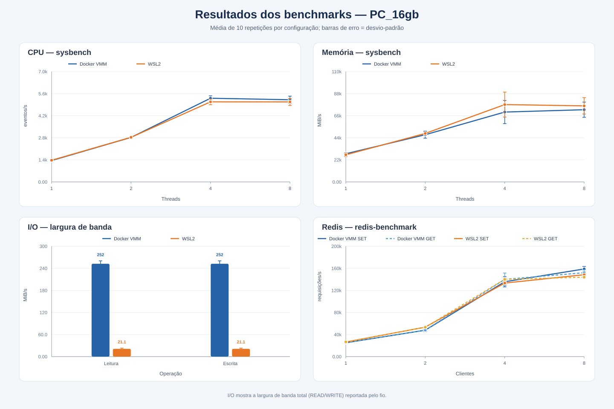
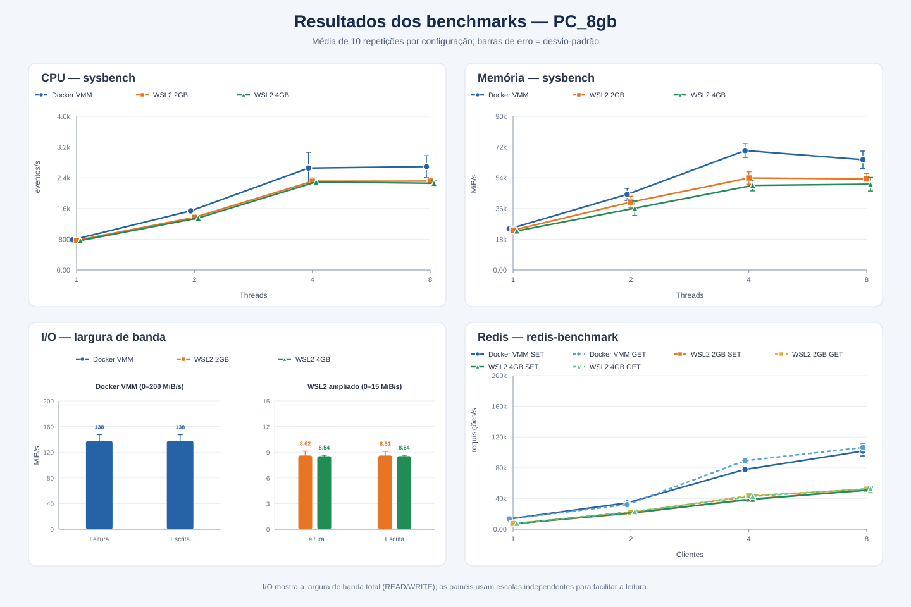

# Relatório do projeto

## 1. Visão geral

O repositório reúne automação e resultados preliminares para comparar workloads executados em WSL2 e Docker VMM. Os testes cobrem CPU, memória, I/O e Redis. Os scripts estão separados por ambiente: os scripts WSL2 identificam o cenário como `wsl2`, e os scripts Docker VMM usam `docker_vmm_4gb`. Os resultados estão organizados por plataforma e máquina.

## 2. O que foi implementado e registrado

- Oito scripts originais de benchmark: quatro em Bash e quatro em PowerShell, além dos scripts PowerShell compartilhados descritos abaixo.
- Quatro workloads:
  - **W1 — CPU:** sysbench, limite de primos 20.000, 1, 2, 4 e 8 threads.
  - **W2 — Memória:** sysbench, blocos de 1.024 KiB, transferência total de 10.240 MiB, 1, 2, 4 e 8 threads.
  - **W3 — I/O:** fio, leitura/escrita randômica, blocos de 4 KiB, arquivo de 256 MiB, dois jobs, profundidade 16 e execução de 20 segundos.
  - **Redis:** `redis-benchmark`, operações SET e GET, 100.000 requisições e concorrência de 1, 2, 4 e 8 clientes.
- Cada configuração é repetida dez vezes. Os scripts gravam saídas em arquivos separados por repetição e nível de concorrência/thread.
- O diretório `resultados_preliminares/PC_16gb` contém **260 logs**: 130 para Docker VMM e 130 para WSL2. Para cada plataforma há 40 arquivos de CPU, 40 de memória, 10 de I/O e 40 de Redis.
- O script `Scripts/gerar_csv_benchmarks.py` exporta os resultados de PC_16gb ou PC_8gb para CSV; `Scripts/gerar_csv_16gb.py` permanece como atalho compatível para PC_16gb.
- Os arquivos gerados são [`resultados_16gb_wsl2_vs_docker_vmm.csv`](resultados_preliminares/PC_16gb/resultados_16gb_wsl2_vs_docker_vmm.csv) e [`resultados_8gb_wsl2_2gb_4gb_vs_docker_vmm.csv`](resultados_preliminares/PC_8gb/resultados_8gb_wsl2_2gb_4gb_vs_docker_vmm.csv). O CSV de 16 GB foi regenerado para corrigir o cálculo agregado do I/O.
- O diretório `resultados_preliminares/PC_8gb` contém **390 logs de benchmark**: 130 para Docker VMM e 130 para cada configuração WSL2 (2 GB e 4 GB). Cada configuração inclui 40 arquivos de CPU, 40 de memória, 10 de I/O e 40 de Redis.
- Os quatro scripts da pasta WSL2 foram ajustados para definir `CENARIO="wsl2"`, identificando corretamente o ambiente nos diretórios de saída.
- A pasta `Scripts/Unificado` contém um script PowerShell por workload (CPU, memória, I/O e Redis). Eles usam o Docker CLI sem selecionar o hipervisor; essa seleção permanece no Docker Desktop.
Os scripts compartilham `DockerBenchmark.ps1`, que registra `stdout` e `stderr` nos logs e usa o código de saída do Docker para identificar falhas. Assim, avisos do sysbench em `stderr` não interrompem a execução no Windows PowerShell.

Para gerar os CSVs a partir dos logs:

```powershell
python Scripts/gerar_csv_benchmarks.py PC_16gb
python Scripts/gerar_csv_benchmarks.py PC_8gb
```

O formato é longo (uma linha por métrica) e mantém unidade, repetição, backend e memória configurada. Métricas que não aparecem nos logs ficam vazias, não são tratadas como zero. No I/O, largura de banda e IOPS representam o total dos dois jobs do fio; latências e percentis são identificados por job porque o log não fornece percentis agregados.

Para executar uma rodada, selecione o backend desejado no Docker Desktop, abra o PowerShell na pasta da máquina (`resultados_preliminares/PC_8gb` ou `resultados_preliminares/PC_16gb`) e chame o script com um rótulo para separar a saída. Por exemplo:

```powershell
& ..\..\Scripts\Unificado\executar_cpu_bound.ps1 -Cenario wsl2
& ..\..\Scripts\Unificado\executar_memory_bound.ps1 -Cenario wsl2
& ..\..\Scripts\Unificado\executar_io_bound.ps1 -Cenario wsl2
& ..\..\Scripts\Unificado\executar_redis_cloud_native.ps1 -Cenario wsl2
```

Para a outra rodada, selecione o outro backend no Docker Desktop e use outro rótulo, como `docker_vmm_4gb`. O parâmetro `-Cenario` serve apenas para nomear as pastas de resultados; ele não escolhe nem verifica o hipervisor. Cada execução cria ou sobrescreve os logs daquela configuração no diretório de trabalho atual.

## 3. Histórico registrado

O histórico Git mostra esta sequência:

1. **29/10/2026 — commit inicial:** criação do repositório.
2. **29/10/2026 — automação:** inclusão dos scripts de benchmark para WSL2 e Docker VMM.
3. **30/10/2026 — resultados preliminares:** inclusão dos logs das execuções.
4. **30/10/2026 — organização:** movimentação dos resultados para a estrutura `PC_16gb`.

## 4. Síntese quantitativa dos resultados

Os valores abaixo são médias aritméticas calculadas a partir dos CSVs, que registram as métricas extraídas dos logs originais. CPU e memória foram agrupadas por número de threads; I/O corresponde à largura de banda média registrada para leitura e escrita; Redis usa a taxa final de requisições por segundo. Há dez repetições por configuração.

### PC_16gb

O gráfico abaixo compara as médias das dez repetições; as barras de erro mostram o desvio-padrão. Os marcadores e o pequeno deslocamento horizontal ajudam a distinguir séries sobrepostas. No painel de I/O, Docker VMM e WSL2 usam escalas independentes; o zoom do WSL2 está identificado no próprio gráfico.



### CPU — eventos por segundo

| Threads | Docker VMM | WSL2 |
|---:|---:|---:|
| 1 | 1.354,4 | 1.375,4 |
| 2 | 2.823,4 | 2.829,9 |
| 4 | 5.307,3 | 5.079,4 |
| 8 | 5.214,4 | 5.074,7 |

O resultado cresce até quatro threads e pouco muda ou cai levemente em oito. As diferenças entre plataformas são pequenas, com vantagem do Docker VMM em quatro e oito threads e do WSL2 em uma e duas.

### Memória — MiB/s

| Threads | Docker VMM | WSL2 |
|---:|---:|---:|
| 1 | 28.086,0 | 27.003,4 |
| 2 | 47.071,6 | 48.325,2 |
| 4 | 69.672,8 | 77.098,2 |
| 8 | 71.988,7 | 75.804,2 |

O WSL2 registra maior throughput em duas, quatro e oito threads; o Docker VMM, em uma thread. O ganho de throughput diminui ao passar de quatro para oito threads.

### I/O — largura de banda por tipo de operação

| Operação | Docker VMM | WSL2 |
|---|---:|---:|
| Leitura | 252,4 MiB/s | 21,1 MiB/s |
| Escrita | 252,4 MiB/s | 21,1 MiB/s |

Nos logs analisados, o Docker VMM registra aproximadamente 12 vezes a largura de banda do WSL2. É a diferença mais expressiva do conjunto.

### Redis — requisições por segundo

| Clientes | Operação | Docker VMM | WSL2 |
|---:|:---|---:|---:|
| 1 | SET | 25.127 | 26.330 |
| 1 | GET | 25.227 | 26.656 |
| 2 | SET | 47.855 | 53.447 |
| 2 | GET | 48.047 | 53.294 |
| 4 | SET | 135.648 | 133.270 |
| 4 | GET | 140.034 | 140.001 |
| 8 | SET | 158.875 | 148.415 |
| 8 | GET | 152.070 | 143.928 |

O WSL2 apresenta taxas maiores com um e dois clientes. Com quatro clientes, os resultados são próximos; com oito, o Docker VMM apresenta taxas maiores. O aumento de concorrência eleva o throughput observado, embora não de forma proporcional.

### PC_8gb — Docker VMM e WSL2 com 2 GB e 4 GB

Os resultados seguintes são médias aritméticas das dez repetições de cada configuração no CSV do PC_8gb. Para WSL2, a comparação distingue as configurações de 2 GB e 4 GB.

#### CPU — eventos por segundo

| Threads | Docker VMM | WSL2 2 GB | WSL2 4 GB |
|---:|---:|---:|---:|
| 1 | 787,1 | 770,7 | 765,9 |
| 2 | 1.538,3 | 1.369,7 | 1.353,4 |
| 4 | 2.652,8 | 2.310,2 | 2.293,0 |
| 8 | 2.691,0 | 2.313,7 | 2.257,4 |

#### Memória — MiB/s

| Threads | Docker VMM | WSL2 2 GB | WSL2 4 GB |
|---:|---:|---:|---:|
| 1 | 24.089,7 | 23.332,0 | 22.879,2 |
| 2 | 44.278,8 | 39.788,4 | 36.187,0 |
| 4 | 69.944,0 | 53.907,4 | 49.547,8 |
| 8 | 64.606,4 | 53.280,0 | 50.266,7 |

#### I/O — largura de banda

| Operação | Docker VMM | WSL2 2 GB | WSL2 4 GB |
|---|---:|---:|---:|
| Leitura | 137,5 MiB/s | 8,62 MiB/s | 8,54 MiB/s |
| Escrita | 137,7 MiB/s | 8,61 MiB/s | 8,54 MiB/s |

#### Redis — requisições por segundo

| Clientes | Operação | Docker VMM | WSL2 2 GB | WSL2 4 GB |
|---:|:---|---:|---:|---:|
| 1 | SET | 13.484 | 7.158 | 7.570 |
| 1 | GET | 13.445 | 7.404 | 7.791 |
| 2 | SET | 34.340 | 20.857 | 21.791 |
| 2 | GET | 32.014 | 21.716 | 23.112 |
| 4 | SET | 77.826 | 39.165 | 39.079 |
| 4 | GET | 89.188 | 43.776 | 42.917 |
| 8 | SET | 101.768 | 50.981 | 51.222 |
| 8 | GET | 106.419 | 51.993 | 52.961 |

### Análise visual — PC_8gb

O gráfico compara as médias das dez repetições do Docker VMM e do WSL2 com 2 GB e 4 GB; as barras de erro mostram o desvio-padrão entre repetições. Os marcadores e o pequeno deslocamento horizontal ajudam a distinguir séries sobrepostas. No painel de I/O, Docker VMM e WSL2 usam escalas independentes; o zoom do WSL2 está identificado no próprio gráfico.



- **WSL2, CPU:** a configuração de 2 GB fica ligeiramente acima da de 4 GB em todos os níveis de threads; a diferença chega a cerca de 2,5% com oito threads.
- **WSL2, memória:** 2 GB supera 4 GB em duas, quatro e oito threads; com uma thread, os resultados são próximos.
- **WSL2, I/O:** os resultados são praticamente iguais entre 2 GB e 4 GB, com pequena vantagem para 2 GB.
- **WSL2, Redis:** 4 GB fica ligeiramente acima na maioria das configurações; com quatro clientes, 2 GB fica um pouco à frente.
- **Docker VMM:** registra throughput maior que as configurações WSL2 nos workloads de CPU, memória, I/O e Redis.

Esses resultados descrevem cada PC e a configuração avaliada; não devem ser generalizados para outros hosts sem novas medições. O gerador de gráficos lê os CSVs correspondentes e calcula as médias e os desvios-padrão a partir das repetições, sem reler os logs brutos. Se os logs dos benchmarks mudarem, gere primeiro o CSV atualizado; em seguida, recrie os gráficos com `python Scripts/gerar_grafico_pc.py PC_8gb` ou `python Scripts/gerar_grafico_pc.py PC_16gb`.

## 5. Leitura geral

- **CPU:** desempenho próximo entre as plataformas; o melhor resultado varia com o número de threads.
- **Memória:** WSL2 tem vantagem nas configurações de maior concorrência, enquanto Docker VMM lidera em uma thread.
- **I/O:** Docker VMM aparece muito à frente nos dados coletados.
- **Redis:** resultados mistos conforme a concorrência, sem uma plataforma vencedora em todas as configurações.
- **PC_8gb:** os dados incluem Docker VMM e WSL2 com 2 GB e 4 GB. Entre as configurações WSL2, a diferença depende do workload: CPU e memória favorecem em geral 2 GB, Redis favorece ligeiramente 4 GB e I/O é parecido.

## 6. Conclusão

O projeto reúne scripts de automação para executar quatro workloads em WSL2 e Docker VMM. Os resultados incluem 260 logs no PC de 16 GB e benchmarks de Docker VMM, WSL2 com 2 GB e WSL2 com 4 GB no PC de 8 GB. No PC de 16 GB, CPU e Redis variam conforme a concorrência; memória favorece o WSL2 em várias configurações, e I/O favorece o Docker VMM. No PC de 8 GB, a diferença entre as duas configurações WSL2 depende do workload, enquanto Docker VMM apresenta médias maiores na maior parte das medições.
